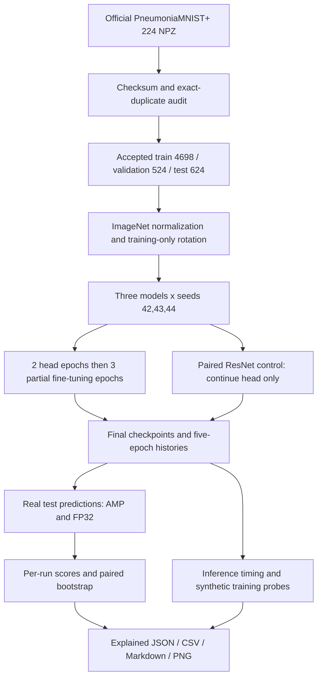

# Research pipeline for supervisor review

## Question

Compare ImageNet-pretrained ResNet-18, DenseNet-121 and MobileNetV3-Small for pediatric pneumonia versus normal classification under the same short training budget. Measure predictive performance, device cost and a small optimization proof of concept on a 6 GB RTX 4050 laptop GPU.

## Flow

## Data and preprocessing

The canonical dataset is `archive/pilot_2026-10-22/data/pneumoniamnist_224.npz`. Class 0 is normal and class 1 is pneumonia. Use actual 224-pixel images. Remove development images exactly matching held-out data by SHA-256; train/validation overlaps remove ten training rows. Keep within-split duplicates for the adopted recipe. Bootstrap test duplicates together using 621 exact-image groups; patient identifiers are unavailable.

Store the audited indices and retain their original order. Repeat grayscale into three channels, divide uint8 values by 255, and apply ImageNet channel means [0.485,0.456,0.406] and standard deviations [0.229,0.224,0.225]. Training alone rotates by a uniform angle in [-5,+5] degrees with bilinear sampling and border padding. Do not augment validation or test images.

## Training implementation

| Setting | Value |
|---|---|
| Models | torchvision ImageNet-1K V1 ResNet-18, DenseNet-121, MobileNetV3-Small |
| Output | One binary logit |
| Seeds | 42, 43, 44 |
| Batch | 16 |
| Epochs 1–2 | Head only, AdamW learning rate 0.001 |
| Epochs 3–5 | Partial fine-tuning, AdamW learning rate 0.0001 |
| Weight decay | 0.0001 |
| Loss | BCEWithLogitsLoss, positive weight = 1214/3484 |
| Precision | Float32 parameters, CUDA float16 autocast, GradScaler initial scale 1024 |
| Batch normalization | Running statistics fixed in all phases |
| Selection | Fixed final epoch; no early stopping or threshold search |
| Partial ResNet | `layer4` and `fc` |
| Partial DenseNet | `denseblock4`, `norm5`, classifier |
| Partial MobileNet | Last two feature modules and classifier |

Only named trainable parameters enter each fresh phase optimizer. ResNet frozen and partial branches share the identical epoch-2 state, then receive the same three extra epochs, learning rate, data order and rotation draws. MobileNet's full classifier includes its hidden layer and dropout. The model stays in eval mode except the classifier, so BN running means/variances stay fixed while declared affine parameters can learn.

This creates nine primary comparison runs and three frozen ResNet controls. Shared ResNet warm-up is counted once when estimating total actual training time. Shared warm-up rows appear in both branch histories for traceability.

## Evaluation and statistics

For every final checkpoint, predict all 624 test examples at batch 64 with a smaller final batch. Use sigmoid probabilities; classify pneumonia when probability >= 0.5. Primary AUROC, average precision, F1, precision, recall, specificity, accuracy and balanced accuracy are computed per seed. Report means and sample SD over three seeds, not a probability ensemble. Seed 42 supplies illustrative curves and confusion matrices.

Use 2,000 paired hierarchical bootstrap replicates with RNG seed 20261022: sample 621 exact-image groups with replacement and sample three training seeds with replacement. Use identical sampled groups and seeds in compared models. Report percentile 95% intervals for AUROC and the three declared paired differences. These intervals are exploratory and not multiplicity-adjusted. Unknown patient clusters remain a limitation.

## Optimization and hardware proof

1. Compare paired frozen versus partially fine-tuned ResNet test AUROC and training cost.
2. Compare FP32 and AMP real-test probabilities and fixed-threshold decisions.
3. Measure isolated batch-1 forward latency using three interleaved precision rounds, 30 warm-ups and 200 CUDA-event-timed forwards per case. Timing inputs are fresh random tensors of the same shape per case; numerical consistency uses identical real images. Exclude decoding, normalization and transfer from latency claims.
4. Probe AMP inference batches 16,32,64,128 with five warm-ups and thirty forwards.
5. On disposable checkpoint copies, enable all parameter gradients and measure synthetic AdamW training steps at FP32 batch 16 and AMP batches 16,32,64. Use three warm-ups and ten measured steps, fixed BN statistics and unweighted BCE with alternating synthetic labels.
6. Stop each architecture's probe on OOM or after a completed workload exceeding 70% of physical VRAM in peak tensor allocation. Tested successful batches are feasible workloads, not absolute limits.

## Evidence to present

Start with Python settings and `experiment.py`, then show the command launcher, an epoch log, checkpoint replay, per-seed CSV, comparison CSV and the full report with figures. Open `results_explained.json` to show that each numeric model result, paired comparison and hardware finding includes a plain-language description in that same file. CSV and Markdown remain available for review without JSON tools.

The three architecture difference intervals need not support a reliable ranking even if their mean AUROCs differ. A positive fine-tuning signal does not establish model compression. Synthetic speedups do not establish better classification or guaranteed end-to-end acceleration. The measured pediatric task does not support adult multi-disease or clinical claims.