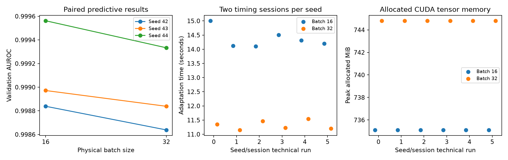

# Completed batch-size optimization pilot

Protocol: `cxr_batch32_v2_pilot`. Completed UTC: 2026-11-19T09:37:19.801948+00:00.

**Decision: Batch 32 meets the predefined engineering pilot criteria; it is a candidate for this ResNet recipe.**

## Baseline versus candidate

| Setting | Validation AUROC mean +/- seed SD | Mean validation F1 | Median adaptation seconds (6 technical runs) | Max allocated MiB | Steps / 3 epochs |
| --- | --- | --- | --- | --- | --- |
| Batch 16 | 0.999124 +/- 0.000385 | 0.992699 | 14.253 | 735.1 | 882 |
| Batch 32 | 0.998937 +/- 0.000358 | 0.990082 | 11.290 | 744.8 | 441 |

Mean paired validation AUROC change: **-0.000187** (-0.0187 percentage points). Worst seed change: -0.000229.
Median paired timing speedup: **1.253x**; corresponding adaptation-time reduction: 20.17%.

## Per-seed paired changes

| Seed | AUROC change | F1 change | Session 1 speedup | Session 2 speedup |
| --- | --- | --- | --- | --- |
| 42 | -0.000200 | -0.005249 | 1.322x | 1.292x |
| 43 | -0.000133 | -0.001340 | 1.266x | 1.240x |
| 44 | -0.000229 | -0.001264 | 1.230x | 1.267x |

## Predefined acceptance checks

- PASS: all twelve runs completed with finite losses.
- PASS: no skipped amp updates.
- PASS: peak allocated memory below 70 percent.
- PASS: mean validation auroc drop at most 0 005.
- PASS: each seed validation auroc drop at most 0 010.
- PASS: median paired speedup at least 1 10.
- PASS: technical sessions reproduce final weights.
- PASS: checkpoint validation replay passes.
- PASS: original checkpoints unchanged.

## Method, interpretation and limits

Both settings start from the same saved epoch-2 state per seed, then train layer4 and the output head for three epochs with AdamW lr=0.0001, weight decay=0.0001, weighted BCE and AMP. BatchNorm statistics remain frozen. Head warm-up is not repeated or included in timing. Final epoch is used without validation checkpoint selection. Classification threshold is 0.5.

Each seed uses the same shuffled image order and per-image rotations in both branches. Full-epoch angle generation differs from v1 per-batch RNG draws; this version reruns its own batch-16 control. Both settings see 14,094 training-image presentations. Batch 32 makes 441 optimizer updates versus 882 for batch 16. Any speed gain includes this reduction in update count; it is not proof of a faster mathematical optimizer or a universally superior batch size.

Two sessions reverse execution order within each seed. Model/validation kernels are warmed using disposable gradients before measured adaptation, then weights are restored. The measured interval includes training, order/augmentation setup and per-epoch validation; it excludes loading and checkpoint writing. The paired speedup is the median of per-seed medians across sessions, not the ratio of the table medians. Thermal and background workload variations remain possible.

GPU: NVIDIA GeForce RTX 4050 Laptop GPU, physical VRAM 6140.5 MiB. The allocated-memory criterion is 4298.3 MiB. Peak reserved values are in summary.csv; nvidia-smi snapshots are in history records. Allocated tensor memory does not measure every driver allocation or total system peak.

The three seeds quantify training variability. Repeated sessions are timing repetitions and reproduce identical final weights; they are not six independent predictive experiments. The tolerances are engineering screens, not statistical non-inferiority/equivalence evidence. No test arrays, test predictions or test labels are loaded. The previously inspected v1 test split remains previously inspected.

This optimization concerns ResNet only. It changes neither architecture size nor checkpoint size, and establishes no maximum possible GPU optimization. DenseNet and MobileNet retain their existing validated batch-16 recipe. A failed pilot is retained and reported without post-hoc parameter tuning.

## Reproduce and inspect

From the project root, run the following using the recorded CUDA Python. A fresh directory is required to train again:

```powershell
& 'C:\Users\kanaa\Documents\Codex\ml-gpu-env\Scripts\python.exe' -B -u 04_implementation/src/batch32_pilot.py --run-dir 05_experiments/batch32_v2_repeat
```

Verify the retained pilot without training:

```powershell
& 'C:\Users\kanaa\Documents\Codex\ml-gpu-env\Scripts\python.exe' -B 04_implementation/src/batch32_pilot.py --verify
```

Primary evidence: [runs.csv](runs.csv), [summary.csv](summary.csv), [paired comparisons](paired_comparisons.csv), [epoch history](epoch_history.csv), [explained JSON](results_explained.json), [protocol](protocol.json), [environment](environment.json), [input hashes](inputs.json). Source snapshots are in source/. Final weights are in checkpoints/ and validation predictions in predictions/. Keep the whole project for offline dependencies and data.


