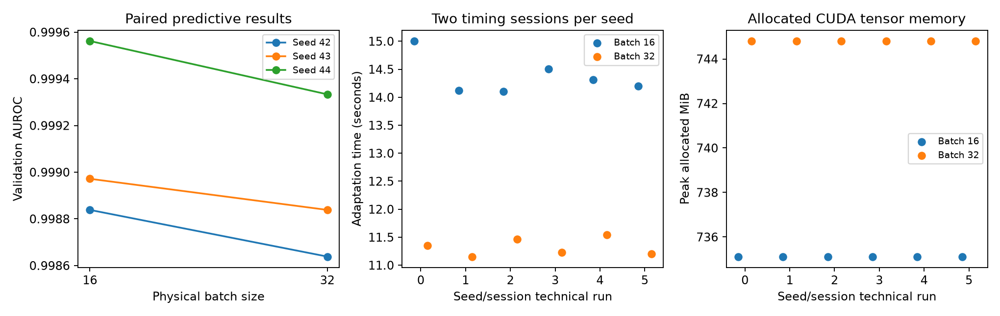

# Batch-size optimization — completed 19 November 2026

Batch 32 meets the predefined engineering pilot criteria; it is a candidate for this ResNet recipe. Median paired speedup was **1.253x**, equivalent to **20.17% less measured adaptation time**. Mean paired validation AUROC changed by **-0.000187** (-0.0187 percentage points). All 129 independent verification checks passed.

| Physical batch | Validation AUROC mean +/- seed SD | Mean validation F1 | Median adaptation seconds | Max allocated MiB |
| --- | --- | --- | --- | --- |
| 16 | 0.999124 +/- 0.000385 | 0.992699 | 14.253 | 735.1 |
| 32 | 0.998937 +/- 0.000358 | 0.990082 | 11.290 | 744.8 |

These are validation results for ResNet-18 only, with three seeds and two technical timing sessions per seed/settings pair. Timing includes three adaptation epochs and per-epoch validation, excluding model loading, warm-up and checkpoint saving. Two sessions reproduce the same trained states and do not increase the number of independent seeds. Batch 32 halves optimizer updates from 882 to 441 over the same 14,094 training-image presentations. V2 pre-generates paired rotations for the full epoch and therefore reruns its own batch-16 control. Do not compare these validation scores directly to the earlier v1 test table. No new test evaluation or statistical equivalence claim is made. The v1 test set remains previously inspected. The gain does not change model parameter count or establish a hardware optimization ceiling.

Primary evidence: [full method and results](../05_experiments/batch32_v2_pilot/OPTIMIZATION_REPORT.md), [per-run CSV](../05_experiments/batch32_v2_pilot/runs.csv), [paired comparisons](../05_experiments/batch32_v2_pilot/paired_comparisons.csv), [independent review](../05_experiments/batch32_v2_pilot/INDEPENDENT_REVIEW.md), [explained JSON](../05_experiments/batch32_v2_pilot/results_explained.json), [runner](../04_implementation/src/batch32_pilot.py).

Reproduce with `./optimize.ps1 -RunDir 05_experiments/batch32_repeat_new`. Verify the retained pilot with `./optimize.ps1 -Stage verify`. Review its statistics with `./optimize.ps1 -Stage review`. The default retained run directory is never overwritten.
