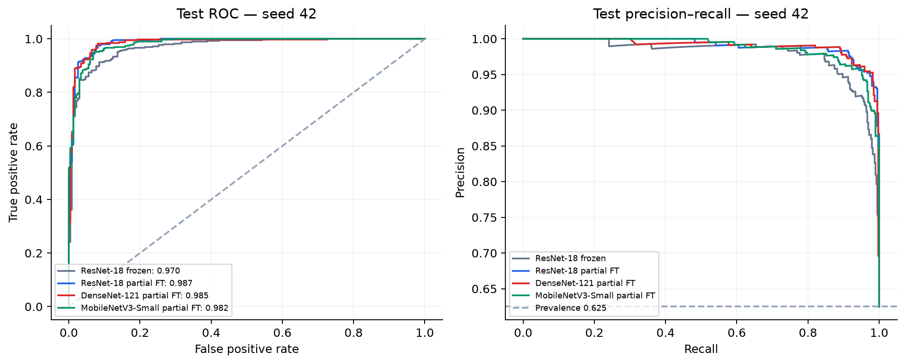
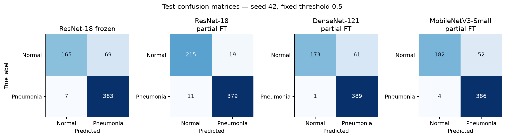
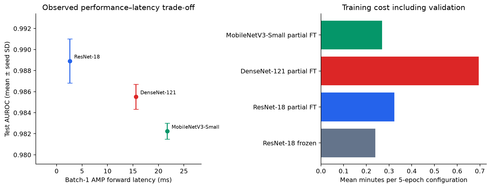
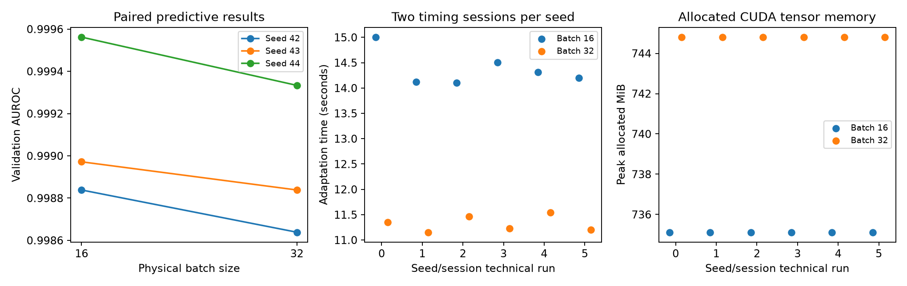

# Comparative Analysis and Resource-Aware Optimization of Deep Learning Models for Pediatric Pneumonia Classification

**BTech Final-Year Research Report**

| Detail | Information |
| --- | --- |
| Institution / Department | Netaji Subhas University of Technology / CSDS |
| Course | IRS |
| Team members | Kanav Singla, Utkarsh Dubey and Dushyant Bhardwaj |
| Roll numbers | 2023UCD3014, 2023UCD3059 and 2023UCD2163 |
| Supervisor | Ms. Ayushi |
| Report updated | 19 November 2026 |

## 1. Introduction

Deep learning models can learn patterns from images and use them for classification. Convolutional neural networks (CNNs) are relevant to chest X-ray analysis because they can learn image features without manually designed feature extraction. However, selecting a model involves more than choosing the highest reported accuracy. Training time, GPU memory, model size and consistency across repeated runs also affect whether a method is practical for a student project.

This project compares **ResNet-18, DenseNet-121 and MobileNetV3-Small** for classifying pediatric chest X-rays as normal or pneumonia. We use transfer learning, in which a network pretrained on ImageNet is adapted to the target task. The experiments use a laptop with an NVIDIA RTX 4050 GPU and approximately 6 GB of GPU memory.

The study has two parts. First, we compare the models under a common training procedure. Second, we examine optimization through partial fine-tuning, precision measurements and a controlled batch-size experiment. The aim is to identify useful performance-resource trade-offs within the available hardware budget.

### 1.1 Problem Statement

The problem addressed in this project is:

> How do ResNet-18, DenseNet-121 and MobileNetV3-Small compare in pediatric pneumonia classification under the same short training procedure, and can training time be reduced while keeping the loss in validation performance within predefined limits?

The input is a 224 × 224 grayscale chest X-ray. The output is a score used to classify the image into one of two dataset classes: normal or pneumonia. The scope is limited to this binary benchmark. Disease localization, severity assessment, other chest conditions and clinical diagnosis are outside the scope.

Results from a single run can depend on random initialization and training order. Each model is therefore trained using three random seeds, and results are reported as means with variation across runs.

### 1.2 Motivation

The main motivation is to conduct an understandable and reproducible comparison using resources available to students. Large medical foundation models show important progress, but their complete pretraining procedures are beyond this project's resources. Established pretrained CNNs allow us to study transfer learning at a manageable scale.

We also investigate two common assumptions: that a deeper model always performs better, and that a smaller model always runs faster. Existing architecture-comparison studies show why these assumptions should be tested on the target task and hardware [R6, R7].

Finally, a research project should produce evidence that can be checked. We retain training code, dataset indices, trained weights, predictions, CSV tables and figures so that the models can be demonstrated and the calculations reproduced.

### 1.3 Novelty and Contribution

The contribution is **an experimental comparison and practical optimization study**, rather than a new neural network architecture. CNN-based pneumonia classification, transfer learning and batch-size tuning are established methods.

Our specific contributions are:

1. A comparison of three pretrained CNNs using the same accepted splits, image size, training budget and evaluation procedure.
2. A paired ResNet experiment measuring partial fine-tuning against continued head-only training from the same starting weights.
3. A validation-only batch-size pilot measuring training time, predictive performance and memory use on an RTX 4050 laptop GPU.
4. A reproducible record containing executable Python, trained checkpoints, saved predictions and independently checked tables.

This is an incremental contribution suitable for an undergraduate project. Its value lies in the quality of the comparison and the explanation of measured trade-offs.

### 1.4 Objectives

The objectives are to compare predictive performance, measure resource requirements, evaluate a small optimization and explain the findings accurately. We investigate whether the model with the highest ranking performance also has the best fixed-threshold performance, and whether a larger training batch provides a useful speed improvement.

## 2. Literature Review

The review covers foundational CNN architectures, chest X-ray benchmarks, transfer learning and recent medical foundation models. Table 1 compares **13 research papers**, including five published in 2025-2026. These studies provide different types of evidence and are not treated as one common leaderboard.

### 2.1 Comparison of Research Papers

**Table 1. Comparison of the literature reviewed.** Findings refer to each paper's experiments. The final column explains relevance or scope differences; it does not imply that every difference is an omission in the original work.

| Ref. | Paper and year | Dataset / setting | Method and contribution | Relevance or scope difference |
| --- | --- | --- | --- | --- |
| [R1] | He et al., *Deep Residual Learning for Image Recognition*, 2016 | ImageNet, CIFAR-10 and detection | Introduced residual connections to support optimization of deep networks. | Architectural basis for ResNet-18; original results are not pneumonia results. |
| [R2] | Huang et al., *Densely Connected Convolutional Networks*, 2017 | ImageNet and other recognition benchmarks | Connected layers within dense blocks to reuse features and improve information flow. | Motivates DenseNet-121; its resource cost must be measured on our task. |
| [R3] | Howard et al., *Searching for MobileNetV3*, 2019 | ImageNet and mobile vision | Combined hardware-aware search and network design to develop Large and Small variants. | Provides a compact model; mobile CPU efficiency does not guarantee the lowest RTX GPU latency. |
| [R4] | Rajpurkar et al., *CheXNet*, 2017 | ChestX-ray14 and radiologist-annotated evaluation | Used a 121-layer CNN and reported a task-specific radiologist F1 comparison. | Supports studying DenseNet-121; its radiologist comparison cannot be extended to our models. |
| [R5] | Irvin et al., *CheXpert*, 2019 | 224,316 radiographs from 65,240 patients | Introduced a benchmark with uncertainty labels and expert evaluation. | Highlights label quality; our dataset is smaller, pediatric and binary. |
| [R6] | Bressem et al., *Comparing different deep learning architectures for classification of chest radiographs*, 2020 | CheXpert and a COVID-19 collection | Compared 16 CNNs using predictive and resource measurements. | Closely motivates our comparison; we study fewer models on a laptop. |
| [R7] | Ke et al., *CheXtransfer*, 2021 | CheXpert; 16 CNN architectures | Investigated ImageNet transfer and parameter efficiency through truncation. | Supports measuring transfer directly; our fine-tuning does not compress the architecture. |
| [R8] | Yang et al., *MedMNIST v2*, 2023 | Standardized 2D and 3D biomedical datasets | Established a lightweight collection with defined splits and baselines. | Dataset-construction reference; we use the later official 224-pixel MedMNIST+ release. |
| [R9] | Ma et al., *A fully open AI foundation model applied to chest radiography*, 2025 | Multiple radiograph datasets | Developed Ark+ with heterogeneous expert labels and cyclic pretraining. | Shows benefits of broader pretraining; we do not reproduce that large training process. |
| [R10] | Yue et al., *CheXWorld*, 2025 | Radiograph pretraining and downstream tasks | Proposed self-supervised modeling of local anatomy, global layout and domain variation. | An alternative representation-learning approach; ours uses accessible pretrained CNNs. |
| [R11] | Yao et al., *EVA-X*, 2025 | X-ray classification and localization | Learned semantic and geometric representations through self-supervision. | Motivates future medical-encoder evaluation; its weights and localization are not tested here. |
| [R12] | Han et al., *CLEAR*, 2026 | Image-report collections and external benchmarks | Used clinical concepts to audit predictions and examine confounding. | Highlights interpretability and external evaluation, which our study does not establish. |
| [R13] | Neo, *Benchmarking knowledge distillation for lightweight pneumonia detection*, 2026 | PneumoniaMNIST; five seeds and transfer tests | Compared a ResNet teacher with a 60,642-parameter TinyCNN; distillation gave no consistent discrimination gain. | Closely relates to efficiency; compression can sacrifice performance and an optimization can fail. |

Full titles and primary-source links appear in the References section.

### 2.2 Main Findings from the Literature

The architecture papers offer different design choices: ResNet uses residual learning, DenseNet emphasizes feature reuse, and MobileNetV3 targets compact computation [R1-R3]. These differences justify including all three models, but do not predict their ranking on our dataset.

The chest X-ray literature emphasizes evaluation quality. CheXpert investigates uncertain labels, while architecture-comparison studies motivate reporting resource use alongside predictive metrics [R5-R7]. Our study therefore includes dataset checks, repeated seeds and hardware measurements rather than accuracy alone.

Ark+, CheXWorld and EVA-X learn representations from broader radiograph collections [R9-R11]. CLEAR introduces a concept-based approach to auditing predictions [R12]. Their published scores cannot be directly compared with our pediatric binary scores because the tasks and evaluation procedures differ.

Neo's study is especially relevant to efficiency: its small student used far fewer parameters, but did not retain the teacher's full predictive performance [R13]. This supports treating optimization as a measured trade-off rather than assuming that smaller or faster always means better.

### 2.3 Published Baselines and Improvements

**Table 2. Selected comparisons within previous papers.** Each row has its own dataset and evaluation setting. AUROC percentage-point changes equal 100 times the difference on the 0-1 scale.

| Study | Evaluation setting | Reported comparison | Interpretation |
| --- | --- | --- | --- |
| Ark+ [R9] | ChestX-ray14, mean AUC across 14 findings, fine-tuning | RAD-DINO: 83.54%; Ark+: 84.43% | +0.89 percentage points within that benchmark. |
| CheXWorld [R10] | VinDr-CXR, full-label evaluation in April 2025 version | MAE: 92.76%; CheXWorld: 95.24% | +2.48 mean-AUROC percentage points. |
| EVA-X [R11] | ChestX-ray14, mean AUC | Medical MAE ViT-S: 82.3%; EVA-X-S: 83.3% | +1.0 percentage point. |
| CLEAR [R12] | VinDr-CXR, zero-shot classification | CheXzero: 75.0%; CLEAR: 78.2% | +3.2 mean-AUROC percentage points in zero-shot evaluation. |
| Neo [R13] | PneumoniaMNIST, mean AUROC across five seeds | ResNet-18 teacher: 0.9735; vanilla TinyCNN: 0.8818 | A smaller student had lower discrimination; distillation did not consistently improve it. |

The first four rows are reported baseline contrasts, not experiments reproduced by us. The last row is a teacher-student trade-off, not an improvement claim. Differences in labels, training data, processing and evaluation prevent ranking these papers against our work using this table.

### 2.4 Position of the Present Work

Our project asks a narrower question: what can be measured and reproduced using three established models and a 6 GB laptop GPU? We compare models on one accepted dataset, isolate a fine-tuning change and test one operational optimization. The literature provides context; our conclusions come from our saved experimental outputs.

## 3. Proposed Methodology

### 3.1 Overall Pipeline

The implemented pipeline follows this sequence:

```text
Official PneumoniaMNIST+ 224 dataset
                  |
       Check labels, splits and exact duplicates
                  |
       Apply normalization and training augmentation
                  |
       Load ImageNet-pretrained CNN
                  |
       Train classification head for 2 epochs
                  |
       Partially fine-tune final feature stage for 3 epochs
                  |
       Repeat with seeds 42, 43 and 44
                  |
       Evaluate saved final models on the test split
                  |
       Compare performance, time, memory and model size
                  |
       Run a separate validation-only ResNet batch-size pilot
```

The original comparison and later optimization are separately versioned. Their scores are not combined into one performance table because they use different evaluation splits and experimental purposes.

### 3.2 Dataset and Data Preparation

We use the official **PneumoniaMNIST+ 224** dataset. Its images are grayscale, with labels `0 = normal` and `1 = pneumonia`. The MedMNIST v2 paper describes the collection, while the later MedMNIST+ release supplies the actual 224 × 224 images used here [R8, D1]. These are not enlarged copies of 28-pixel images.

**Table 3. Accepted dataset split.**

| Split | Normal images | Pneumonia images | Total images |
| --- | --- | --- | --- |
| Training | 1,214 | 3,484 | 4,698 |
| Validation | 135 | 389 | 524 |
| Test | 234 | 390 | 624 |
| Total | 1,583 | 4,263 | 5,846 |

The original training set contained 4,708 images. Exact pixel-hash matching found eight image hashes shared by training and validation, affecting ten training rows. These ten rows were excluded. No exact training-test or validation-test overlap was found. The raw file and original test split were preserved.

Remaining within-split duplicates were retained under the documented benchmark policy. The test split has 624 rows but 621 unique image hashes. Patient identifiers are unavailable, so exact-image checks cannot establish patient independence or detect every near duplicate.

The dataset checksum was checked against official metadata. Accepted source indices were saved to keep the same images across runs.

### 3.3 Image Preprocessing

Images are scaled from 0-255 to [0,1]. The grayscale channel is repeated three times to match the pretrained networks. ImageNet channel means and standard deviations are then applied.

Training images receive random rotations within ±5 degrees. No random crop or horizontal flip is used. Validation and test images receive normalization without random augmentation. Image arrays are cached on the GPU as unsigned 8-bit values; conversion and preprocessing occur per batch.

### 3.4 Selected Models

**ResNet-18:** Residual connections allow a block to learn an adjustment to its input [R1]. The 18-layer model provides a comparatively compact residual baseline. Its classification head is replaced with a single-output layer, and its final residual stage is enabled during partial fine-tuning.

**DenseNet-121:** Dense blocks pass earlier feature maps to later layers, encouraging feature reuse [R2]. We include it as an alternative architecture with an established connection to chest X-ray research [R4]. Its head is replaced, and its final dense block and final normalization are enabled during partial fine-tuning.

**MobileNetV3-Small:** This provides a compact alternative based on mobile-network design [R3]. Its final classifier layer is replaced, and its last two feature modules are enabled during partial fine-tuning. Its compact size is useful for storage, while GPU latency is measured separately.

### 3.5 Training Procedure

**Table 4. Main comparison settings.**

| Setting | Value |
| --- | --- |
| Pretraining | Official torchvision ImageNet-1K V1 weights |
| Input size | 224 × 224; grayscale repeated to three channels |
| Random seeds | 42, 43 and 44 |
| Batch size | 16 |
| Optimizer | AdamW |
| Weight decay | 0.0001 |
| Head-training phase | 2 epochs; learning rate 0.001 |
| Partial fine-tuning phase | 3 epochs; learning rate 0.0001 |
| Training precision | CUDA FP16 automatic mixed precision with gradient scaling |
| Loss | Class-weighted binary cross-entropy with logits |
| Batch-normalization statistics | Frozen throughout training |
| Checkpoint | Fixed final epoch |
| Classification threshold | 0.5 |

The positive-class loss weight is 1,214 / 3,484, approximately 0.34845, calculated only from accepted training labels. Class weighting does not establish that model scores are calibrated probabilities.

Three architectures and three seeds produce nine final models. Three additional frozen-feature ResNet controls bring the original matrix to twelve final runs. Repeating seeds helps expose variation that a single run would hide.

### 3.6 Paired Fine-Tuning Experiment

For each ResNet seed, both branches start from identical weights after two head-training epochs. One continues training only the output head; the other also trains the final residual stage. Both use three additional epochs, the same learning rate, image exposure and matching training randomness. Both start with fresh optimizers.

This tests whether adapting the final feature stage improves performance over continued head-only training. It does not compare fine-tuning with an untrained network, and does not reduce the deployed parameter count.

### 3.7 Evaluation Metrics and Uncertainty

The primary metric is the **area under the receiver operating characteristic curve (AUROC)**. It measures how well pneumonia examples rank above normal examples across thresholds. An AUROC of 0.5 represents chance-level ranking. An AUROC of 0.99 does not mean 99% classification accuracy.

At the fixed threshold of 0.5, we also calculate:

- **Accuracy:** the proportion of all images classified correctly.
- **Precision:** the proportion of predicted pneumonia images carrying the pneumonia label.
- **Sensitivity or recall:** the proportion of pneumonia images detected.
- **Specificity:** the proportion of normal images correctly classified.
- **F1-score:** the harmonic mean of precision and recall.

F1 = 2TP / (2TP + FP + FN), where TP, FP and FN are true positives, false positives and false negatives. Average precision (AP) is also retained in the result tables to summarize the precision-recall curve.

Scores are calculated separately for each model and averaged over three seeds. Standard deviation describes seed variation and is not the same as a confidence interval.

Selected AUROC comparisons use 2,000 paired bootstrap repetitions that resample seeds and exact-image clusters. The same resampled cases are used for both models in each contrast. The intervals remain exploratory: there are only three seeds, patient grouping is unavailable and multiple comparisons are not adjusted.

### 3.8 Hardware and Precision Measurements

The hardware is an NVIDIA GeForce RTX 4050 Laptop GPU with approximately 6 GB of memory. Recorded software includes Python 3.13.7, PyTorch 2.10.0+cu128, torchvision 0.25.0+cu128 and CUDA runtime 12.8.

We measure training duration, allocated GPU memory, saved weight size and isolated forward latency. Training duration includes scheduled validation but excludes setup and weight download. Forward latency excludes image loading, preprocessing and transfer. These timing definitions are kept separate.

FP32 and automatic mixed-precision inference use the same saved weights. Numerical consistency is checked on real images. Separate synthetic training probes investigate memory and step timing; they do not replace experiments on real training data.

### 3.9 Batch-Size Optimization Pilot

The later pilot compares ResNet training batches of 16 and 32. Each branch starts from the same saved two-epoch warm-up weights for its seed and performs three partial fine-tuning epochs. Learning rate, loss, optimizer, trainable modules and image exposure are fixed.

Only training and validation data are loaded. To guarantee matching per-image rotations across batch sizes, angles are generated for the full epoch before batching. This differs from the original per-batch random-number procedure, so the pilot reruns its own batch-16 control.

Both settings see 14,094 training-image presentations. Batch 16 makes 882 optimizer updates and batch 32 makes 441. Any speed improvement includes fewer updates; it is not a pure hardware-only acceleration with otherwise identical optimization behavior.

Two timing sessions reverse execution order. These are technical repetitions of three seeds, not six independent predictive experiments. The acceptance criteria are successful finite-loss runs; allocated memory below 70% of physical VRAM; mean validation AUROC reduction no greater than 0.005; no individual seed reduction greater than 0.010; and median paired speedup of at least 1.10×. These are engineering criteria, not a statistical equivalence test.

### 3.10 Reproducibility

The main implementation is `04_implementation/src/experiment.py`, with executable settings in `settings.py`. The separate pilot is implemented in `batch32_pilot.py`. The project retains state-dictionary checkpoints, source snapshots, indices, histories and predictions. CSV and Markdown provide readable evidence; JSON supplies additional machine-readable records and explanations.

From the project root, evaluate saved main models with:

```powershell
.\run.ps1 evaluate -RunDir '05_experiments/retrained_v1'
```

A new optimization run requires a fresh directory:

```powershell
.\optimize.ps1 -RunDir '05_experiments/batch32_repeat_new'
```

Verify retained pilot files without training:

```powershell
.\optimize.ps1 -Stage verify
```

## 4. Experimental Results

### 4.1 Main Test-Set Comparison

**Table 5. Test performance averaged over three seeds.** All rows use the accepted 624-image test split. The ± values are sample standard deviations across seeds. Threshold-based metrics use 0.5. FT means fine-tuning.

| Configuration | AUROC mean ± SD | F1 mean ± SD | Accuracy | Sensitivity | Specificity |
| --- | --- | --- | --- | --- | --- |
| ResNet-18, frozen-feature control | 0.9695 ± 0.0009 | 0.9131 ± 0.0029 | 0.8835 | 0.9786 | 0.7251 |
| ResNet-18, partial FT | 0.9889 ± 0.0021 | 0.9335 ± 0.0286 | 0.9108 | 0.9889 | 0.7806 |
| DenseNet-121, partial FT | 0.9855 ± 0.0012 | 0.9388 ± 0.0118 | 0.9188 | 0.9949 | 0.7920 |
| MobileNetV3-Small, partial FT | 0.9822 ± 0.0008 | 0.9429 ± 0.0094 | 0.9252 | 0.9863 | 0.8234 |

ResNet achieved the highest observed mean AUROC among the partially fine-tuned models. MobileNet achieved the highest mean F1 and accuracy at the selected threshold. DenseNet achieved the highest mean sensitivity, but also had the longest training duration.

AUROC evaluates ranking across thresholds, whereas F1 and accuracy describe decisions at one threshold. A model can therefore rank cases well without providing the best operating point at 0.5. ResNet's F1 standard deviation of 0.0286 also shows why its mean should not hide operating-point variation between seeds.

The test set contains 390 pneumonia and 234 normal images. Predicting pneumonia for every image gives 62.5% accuracy while failing to identify normal images. We therefore consider accuracy alongside AUROC, sensitivity and specificity.





### 4.2 Effect of Partial Fine-Tuning

**Table 6. Selected paired AUROC differences.**

| Comparison | Mean AUROC change | Exploratory 95% interval |
| --- | --- | --- |
| ResNet partial FT minus frozen-feature control | +0.019417 | +0.011256 to +0.029072 |
| ResNet partial FT minus DenseNet partial FT | +0.003397 | −0.002267 to +0.009940 |
| MobileNet partial FT minus DenseNet partial FT | −0.003269 | −0.008991 to +0.002069 |

Partial fine-tuning improved ResNet's mean AUROC from 0.9695 to 0.9889. This is **1.9417 AUROC percentage points**, not a 1.9417% increase in classification accuracy. The exploratory paired interval is above zero, supporting an improvement within this benchmark and procedure.

The other intervals include zero. The architecture means therefore do not establish a reliable complete ranking, nor do they prove equivalence. The clearest controlled learning improvement is the ResNet frozen-versus-partial comparison.

### 4.3 Model Size and Resource Requirements

**Table 7. Original comparison resource measurements.** Weights are FP32 state dictionaries without optimizer state. Memory is peak allocated tensor memory during training, not total system GPU use. Training time includes validation; latency measures only the forward pass.

| Partially fine-tuned model | Parameters | Weights | Mean training time | Peak allocated memory | Batch-1 FP32 latency |
| --- | --- | --- | --- | --- | --- |
| ResNet-18 | 11,177,025 | 42.71 MiB | 0.323 min | 736.1 MiB | 1.524 ms |
| DenseNet-121 | 6,954,881 | 27.09 MiB | 0.695 min | 717.1 MiB | 10.713 ms |
| MobileNetV3-Small | 1,518,881 | 5.92 MiB | 0.270 min | 462.0 MiB | 15.970 ms |

MobileNet required approximately **86.4% fewer parameters than ResNet**, making it attractive for storage and memory constraints. However, it did not provide the lowest batch-1 GPU latency. Parameter count alone is therefore insufficient for predicting runtime on a particular device.

DenseNet used fewer parameters than ResNet but took longer to train. ResNet combined the highest observed AUROC with the lowest isolated FP32 forward latency. These are observations for the recorded implementation, batch size and hardware.



### 4.4 Precision and Hardware Observations

FP32 was faster than FP16 autocast for isolated batch-1 inference in both recorded sessions. In the fresh session, AMP latency was 2.592 ms for ResNet, 15.584 ms for DenseNet and 21.724 ms for MobileNet, compared with the FP32 values in Table 7. Reduced precision did not automatically improve this workload.

The real-image precision check also found differences. Across 1,872 predictions per model, representing 624 test images for three seeds, partial ResNet changed one threshold decision, DenseNet changed none and MobileNet changed eight. MobileNet's largest absolute score difference was 0.080860. AMP predictions therefore cannot be described as numerically identical to FP32.

Synthetic full-gradient training probes showed lower allocated memory under AMP at batch 16: approximately 25.3% for ResNet, 44.3% for DenseNet and 34.8% for MobileNet in the fresh session. Short timing ratios varied substantially between sessions. All three tested full-gradient AMP batch-64 probes completed; DenseNet allocated approximately 4.17 GiB. These are tested workloads, not absolute GPU capacity estimates or guarantees for long training runs.

### 4.5 Completed Batch-Size Optimization

**Table 8. ResNet validation-only batch-size pilot.** AUROC and F1 average three seeds; SD describes seed variation. Time is the median of six technical runs per setting and covers three adaptation epochs with scheduled validation.

| Measurement | Batch 16 baseline | Batch 32 candidate |
| --- | --- | --- |
| Validation AUROC mean ± SD | 0.999124 ± 0.000385 | 0.998937 ± 0.000358 |
| Mean validation F1 | 0.992699 | 0.990082 |
| Median adaptation time | 14.253 s | 11.290 s |
| Maximum allocated GPU memory | 735.1 MiB | 744.8 MiB |
| Optimizer updates over three epochs | 882 | 441 |

The median paired speedup was **1.2527×**, corresponding to **20.17% less measured adaptation time**. It is calculated from paired seed/session ratios and is not exactly the ratio of the two table medians.

Mean validation AUROC decreased by **0.000187**, or **0.0187 percentage points**. Mean F1 also decreased, from 0.992699 to 0.990082. Batch 32 therefore provides a speed-performance trade-off rather than improving every measure. All predefined engineering criteria were met, including the speed threshold and AUROC-reduction limits.

The result supports batch 32 as a candidate for this ResNet adaptation recipe. It does not establish an improvement for DenseNet or MobileNet and does not reduce model size. These validation scores must not be directly compared with the test scores in Table 5.



### 4.6 Interpretation Relative to Previous Work

Our findings support measuring predictive performance together with efficiency, as motivated by earlier architecture studies [R6, R7]. They also show why an optimization requires evaluation: batch 32 was faster but slightly reduced validation performance. This differs from the teacher-student compression trade-off investigated by Neo [R13].

We do not claim that our AUROC exceeds the capability of Ark+, CheXWorld, EVA-X or CLEAR. Those studies use different datasets, labels and adaptation settings. Their findings provide context; ours address a smaller, reproducible undergraduate experiment.

### 4.7 Verification and Limitations

The original comparison passed 894 independent numerical checks. Original and fresh-run predictive outputs reproduced exactly in the recorded environment. The batch-size pilot passed 129 checks, including independent AUROC and F1 calculations, repeated-prediction checks and checkpoint integrity. Its timing sessions reproduced the same final model states. These checks support reproducibility on this setup, not bitwise equality on every computer.

The main limitations are:

1. **Limited task and dataset:** a processed pediatric binary benchmark cannot establish performance for adults, other diseases or hospital deployment.
2. **Limited independence information:** patient identifiers are unavailable; exact hashes cannot detect every repeated patient or near duplicate.
3. **Prior test exposure:** the test split had been examined before formal protocol adoption. The main comparison is a disclosed educational benchmark, not a newly blinded confirmatory study. The later pilot uses validation only.
4. **Short training budget:** five epochs and three seeds support a small comparison, not a convergence claim or exhaustive tuning study. A common recipe may favor some architectures.
5. **Hardware-specific measurements:** time and memory depend on the device, software, batch size and measurement definition. No theoretical optimization ceiling is established.
6. **Incomplete deployment evaluation:** external validation, calibration and clinician evaluation remain future work. Model scores are not established clinical diagnostic confidence.

## 5. Conclusion

This project compared ResNet-18, DenseNet-121 and MobileNetV3-Small for pediatric pneumonia classification using a common transfer-learning procedure on PneumoniaMNIST+ 224. Repeated seeds, data checks and retained outputs made the comparison reproducible and inspectable.

ResNet-18 achieved the highest observed mean test AUROC of **0.9889**. MobileNetV3-Small achieved the highest mean F1 of **0.9429** at threshold 0.5 and used substantially fewer parameters. DenseNet-121 achieved the highest mean sensitivity. Partial fine-tuning improved ResNet's mean AUROC by **0.0194** over continued head-only training. The architecture-difference intervals did not establish a reliable complete ranking.

The ResNet batch-size pilot met the predefined engineering criteria. Increasing batch size from 16 to 32 reduced measured adaptation time by approximately **20%**, while mean validation AUROC decreased by **0.000187**. This demonstrates practical optimization within a limited computing budget, with its cost reported alongside its benefit.

The contribution is a clear comparative study with measured resource trade-offs and reproducible evidence. Future work should prioritize error analysis, validation-based calibration and independent evaluation before adding complexity. A released medical encoder or a controlled compression experiment could then be evaluated as a separate extension.

## References

[R1] He, K., Zhang, X., Ren, S. and Sun, J. (2016). *Deep Residual Learning for Image Recognition*. CVPR, pp. 770-778. [Official paper](https://openaccess.thecvf.com/content_cvpr_2016/papers/He_Deep_Residual_Learning_CVPR_2016_paper.pdf).

[R2] Huang, G., Liu, Z., van der Maaten, L. and Weinberger, K. Q. (2017). *Densely Connected Convolutional Networks*. CVPR, pp. 4700-4708. [Official paper](https://openaccess.thecvf.com/content_cvpr_2017/papers/Huang_Densely_Connected_Convolutional_CVPR_2017_paper.pdf).

[R3] Howard, A. et al. (2019). *Searching for MobileNetV3*. ICCV. [Official paper](https://openaccess.thecvf.com/content_ICCV_2019/papers/Howard_Searching_for_MobileNetV3_ICCV_2019_paper.pdf).

[R4] Rajpurkar, P. et al. (2017). *CheXNet: Radiologist-Level Pneumonia Detection on Chest X-Rays with Deep Learning*. arXiv:1711.05225. [Paper](https://arxiv.org/abs/1711.05225).

[R5] Irvin, J. et al. (2019). *CheXpert: A Large Chest Radiograph Dataset with Uncertainty Labels and Expert Comparison*. AAAI. [Paper](https://arxiv.org/abs/1901.07031).

[R6] Bressem, K. K. et al. (2020). *Comparing different deep learning architectures for classification of chest radiographs*. Scientific Reports, 10, 13590. DOI: 10.1038/s41598-020-70479-z. [Publisher](https://www.nature.com/articles/s41598-020-70479-z).

[R7] Ke, A., Ellsworth, W., Banerjee, O., Ng, A. Y. and Rajpurkar, P. (2021). *CheXtransfer: Performance and Parameter Efficiency of ImageNet Models for Chest X-Ray Interpretation*. CHIL. DOI: 10.1145/3450439.3451867. [Paper](https://arxiv.org/abs/2101.06871).

[R8] Yang, J. et al. (2023). *MedMNIST v2 - A large-scale lightweight benchmark for 2D and 3D biomedical image classification*. Scientific Data, 10, 41. DOI: 10.1038/s41597-022-01721-8. [Publisher](https://www.nature.com/articles/s41597-022-01721-8).

[R9] Ma, D., Pang, J., Gotway, M. B. and Liang, J. (2025). *A fully open AI foundation model applied to chest radiography*. Nature, 643, pp. 488-498. DOI: 10.1038/s41586-025-09079-8. [Publisher](https://www.nature.com/articles/s41586-025-09079-8), [open full text](https://pmc.ncbi.nlm.nih.gov/articles/PMC13657249/).

[R10] Yue, Y., Wang, Y., Tao, C., Liu, P., Song, S. and Huang, G. (2025). *CheXWorld: Exploring Image World Modeling for Radiograph Representation Learning*. CVPR. Numerical comparisons refer to arXiv:2504.13820v1, 18 April 2025. [Paper and tables](https://arxiv.org/html/2504.13820v1).

[R11] Yao, J. et al. (2025). *EVA-X: a foundation model for general chest x-ray analysis with self-supervised learning*. npj Digital Medicine, 8, 678. DOI: 10.1038/s41746-025-02032-z. [Publisher](https://www.nature.com/articles/s41746-025-02032-z).

[R12] Han, T. et al. (2026). *CLEAR: an auditable foundation model for radiology grounded in clinical concepts*. Nature Biomedical Engineering. DOI: 10.1038/s41551-026-01741-4. [Publisher](https://www.nature.com/articles/s41551-026-01741-4).

[R13] Neo, R. Y. S. (2026). *Benchmarking knowledge distillation for lightweight pneumonia detection: a multi-seed calibration study on PneumoniaMNIST*. BMC Research Notes, 19, 270. DOI: 10.1186/s13104-026-07793-8. [Publisher](https://link.springer.com/article/10.1186/s13104-026-07793-8).

[D1] Yang, J. et al. (2024). *MedMNIST+: 18 standardized datasets with multiple size options*, version 3.0. Official dataset release. [Zenodo](https://zenodo.org/records/10519652). This is a dataset source, not an additional research paper counted in Table 1.
