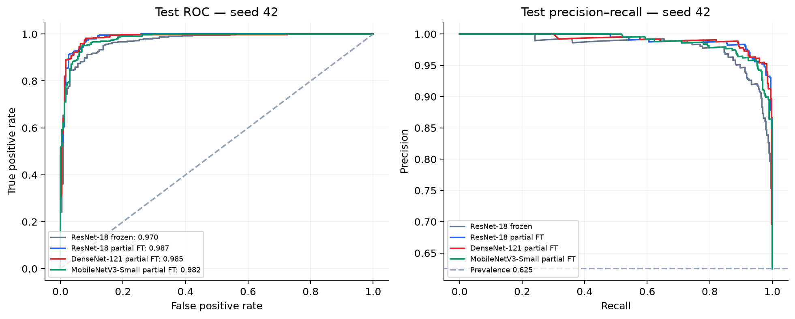
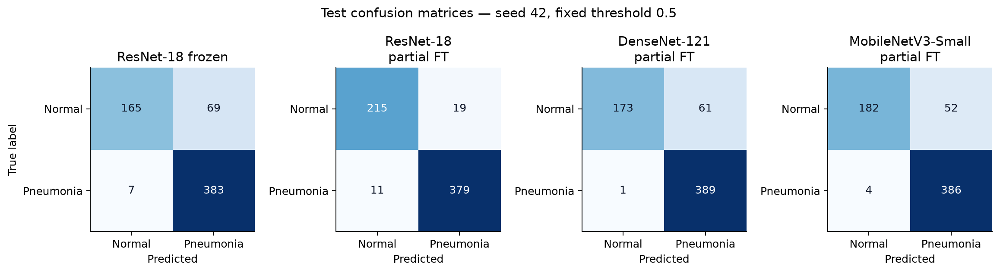
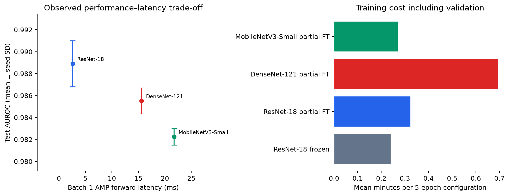
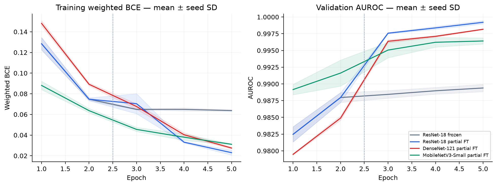
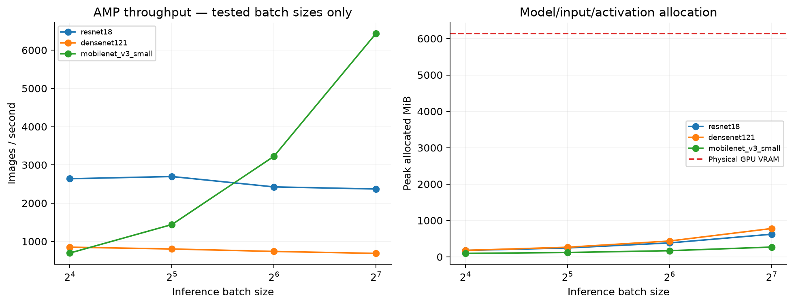
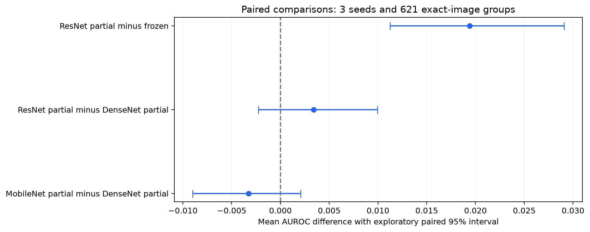
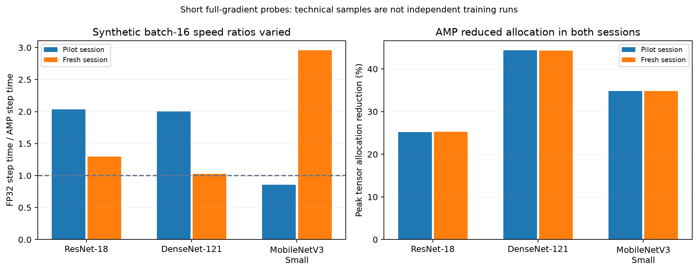

# Comparative Analysis and Optimization of Deep Learning Models on Chest X-rays

**A reproducible three-model comparison for pediatric pneumonia classification**

| Project detail | Recorded information |
| --- | --- |
| College / department | NSUT/CSDS |
| Course name | IRS |
| Team member names | Kanav Singla, Utkarsh Dubey, Dushyant Bhardwaj. |
| Roll / registration numbers | 2023UCD3014, 2023UCD3059, 2023UCD2163 |
| Supervisor / guide | Ms. Ayushi |

Technical scope: PneumoniaMNIST+ 224, three pretrained CNNs, three seeds and a five-epoch recipe. Team details are copied as supplied without inferring a name-to-roll-number mapping. Primary results below use the **fresh retrained_v1 session**. The pilot reproduced the same predictive results; its timing values are kept separate. This technical report does not invent institution-specific formatting approval or a supervisor signature.

Completed: 22 October 2026, 22:18 IST. Hardware: NVIDIA GeForce RTX 4050 Laptop GPU, 6140.5 MiB VRAM. Fresh-training provenance is linked in the reproduction appendix. Analysis generation time is not training completion time. This test split was already examined before formal protocol adoption; this is an educational benchmark, not a newly blinded confirmatory experiment.

## Abstract

We compared ImageNet-pretrained ResNet-18, DenseNet-121, and MobileNetV3-Small on the 224-resolution PneumoniaMNIST+ pediatric pneumonia-versus-normal benchmark. Each architecture used a fixed two-epoch head-training phase followed by three epochs of partial fine-tuning, repeated with seeds 42, 43, and 44. A paired ResNet experiment continued head-only training from the same initial checkpoint. The highest mean test AUROC among the three partially fine-tuned models was 0.9889, achieved by ResNet-18 partial FT. ResNet partial fine-tuning changed mean AUROC by +0.0194 relative to its frozen-feature control, with an exploratory paired 95% interval of [+0.0113, +0.0291]. Training, latency, memory, and precision measurements quantify the observed cost trade-offs on a 6 GB laptop GPU. The findings are limited to this processed pediatric dataset and short training budget.

## 1. Question and contribution

The project asks which of three established pretrained CNN packages provides the most useful observed predictive-performance and resource trade-off under a fixed short training protocol. It also asks whether partial fine-tuning improves a frozen ResNet baseline and whether mixed precision improves inference efficiency on the available GPU.

The contribution is an educational empirical comparison with saved data provenance, exact-duplicate cleanup, three training seeds, paired uncertainty estimates, measured device costs, and a reproducible pipeline. No new architecture or clinical-performance claim is made.

## 2. Related work

Wang et al. introduced report-derived labels for a chest radiograph benchmark. Distinguish the original eight-label release from later fourteen-label updates. [ChestX-ray8](https://arxiv.org/abs/1705.02315)

CheXNet motivates a DenseNet-121 baseline, but its radiologist F1 comparison has a specific test and annotation setting. It does not establish general clinical superiority. [CheXNet](https://arxiv.org/abs/1711.05225)

CheXpert represents uncertainty in report-derived observation labels and evaluates selected findings with experts. Our pediatric binary task and data differ. [CheXpert](https://arxiv.org/abs/1901.07031)

Bressem et al.'s sixteen-architecture study motivates measuring resource costs alongside predictive performance. Its dataset-specific scores are not our measurements. [Architecture comparison](https://www.nature.com/articles/s41598-020-70479-z)

Ke et al. studied transfer and truncation on CheXpert. A nonsignificant drop does not prove equivalence, and our fine-tuning control does not reproduce their truncation experiment. [CheXtransfer](https://arxiv.org/abs/2101.06871)

Yang et al.'s 2023 MedMNIST v2 paper documents the original standardized collection. Our actual 224-pixel MedMNIST+ file is separately identified by its release and checksum. [MedMNIST v2](https://www.nature.com/articles/s41597-022-01721-8), [actual release](https://zenodo.org/records/10519652)

## 3. Dataset, scope, and cleanup

We used the actual 224 × 224 PneumoniaMNIST+ file, not an upscaled 28-pixel version. The file was downloaded from the official MedMNIST+ release and its MD5 matched `d6a3c71de1b945ea11211b03746c1fe1`. It contains pediatric normal/pneumonia images, not adult multi-finding classification. [Official release](https://zenodo.org/records/10519652), [dataset construction](https://www.nature.com/articles/s41597-022-01721-8)

The original splits contained 4,708 training, 524 validation, and 624 test images. Exact SHA-256 image matching found eight unique image hashes shared by training and validation, affecting ten training images. These ten training examples were excluded. No exact train–test or validation–test overlap was found. The working split sizes were **4,698 / 524 / 624**. Within-split duplicate excess was 18 training images before cleanup and 3 test images; the test split was preserved for comparability. Patient identifiers are absent from the NPZ, so patient independence could not be independently verified. Exact-image hashes do not detect all repeat patients or near duplicates.

The test set contains 234 normal and 390 pneumonia labels. A constant majority-class prediction has accuracy 0.625, AUROC 0.5, and AP equal to prevalence (0.625). These references show why accuracy alone is inadequate.

## 4. Protocol

Inputs were grayscale images repeated into three channels, scaled to [0,1] and normalized with ImageNet channel statistics. Training alone used random rotations within ±5°, bilinear sampling, and border padding. There were no flips or random crops. Image arrays were cached on the GPU as uint8; conversion, rotation, and normalization occurred per batch.

All models used ImageNet-1K V1 weights from torchvision 0.25.0+cu128, a one-logit output, batch size 16, weighted BCEWithLogitsLoss with positive weight computed from training labels, and AdamW with weight decay 1e-4. Epochs 1–2 trained the head at learning rate 1e-3. Epochs 3–5 used learning rate 1e-4. The final ResNet residual stage, final DenseNet dense block/normalization, or last two MobileNet feature modules were unfrozen. Batch-normalization running statistics stayed fixed. CUDA FP16 autocast and gradient scaling with initial scale 1024 were used throughout training. TF32 was disabled. Fixed final checkpoints were evaluated; there was no test-dependent checkpoint selection or threshold tuning. Validation/test predictions used evaluation mode and batches of 64, with a smaller final batch where necessary; batch-1 timings are a separate resource measurement.

The ResNet frozen and partial branches started from an identical epoch-2 checkpoint, used the same phase-2 rate, three additional epochs, seed schedule, batch order, and augmentation draws. Fresh optimizers were used for both branches. The saved checkpoint hashes and manifests record the common starting state. This controls training exposure for the fine-tuning comparison.

Each configuration was trained with seeds 42, 43, and 44. The three architecture comparisons use partial fine-tuning. Frozen ResNet is an extra control. Heads and final stages differ in trainable capacity, so this is a comparison of pretrained packages under the chosen recipe rather than a causal isolation of architecture. Training cost includes validation and excludes weight download/setup. Reusing the common ResNet head phase, the actual formal-training duration was approximately **4.3 minutes**.

## 5. Comparative predictive results

AUROC is the primary endpoint. Values below are means across three independently seeded trained checkpoints; ± denotes sample standard deviation across seeds. Other metrics use a fixed 0.5 threshold. AP is average precision, not trapezoidal PR-AUC.

| Configuration | AUROC mean ± seed SD | Exploratory 95% AUROC interval | AP | F1 | Sensitivity | Specificity | Accuracy |
|---|---|---|---|---|---|---|---|
| ResNet-18 frozen | 0.9695 ± 0.0009 | 0.9561–0.9806 | 0.9796 | 0.9131 | 0.9786 | 0.7251 | 0.8835 |
| ResNet-18 partial FT | 0.9889 ± 0.0021 | 0.9814–0.9950 | 0.9921 | 0.9335 | 0.9889 | 0.7806 | 0.9108 |
| DenseNet-121 partial FT | 0.9855 ± 0.0012 | 0.9754–0.9931 | 0.9895 | 0.9388 | 0.9949 | 0.7920 | 0.9188 |
| MobileNetV3-Small partial FT | 0.9822 ± 0.0008 | 0.9727–0.9901 | 0.9883 | 0.9429 | 0.9863 | 0.8234 | 0.9252 |

The highest observed mean AUROC among partially fine-tuned models was **ResNet-18 partial FT**. MobileNetV3-Small's mean AUROC difference from that model was **-0.0067**. These are measurements under this protocol, not universal rankings.

The highest mean F1 at threshold 0.5 was **MobileNetV3-Small partial FT**, at 0.9429 ± 0.0094 across seeds. ResNet partial fine-tuning had F1 0.9335 ± 0.0286. AUROC measures ranking across thresholds; it does not guarantee the best fixed-threshold operating point. The per-seed table exposes the sensitivity/specificity variation rather than hiding it in a single average.

Curves below and confusion matrices use seed 42 as a predefined representative run. They are not ensembles. Aggregate metrics above average per-seed scores, not probabilities.

### Uncertainty and paired differences

We used 2,000 paired hierarchical bootstrap replicates with a fixed RNG seed. Each replicate resampled the three training seeds and the 621 exact-image-hash clusters in the test set, preserving repeated identical-image membership. The same resampled seeds and cases were used for both models in each difference. Intervals are percentile intervals for mean AUROC. They remain exploratory with only three seeds and unknown patient clustering; they are not multiplicity-adjusted confirmatory tests.

| Comparison | Mean AUROC difference | Exploratory 95% interval | Differences for seeds 42, 43, 44 |
|---|---|---|---|
| ResNet-18 partial FT minus ResNet-18 frozen | +0.0194 | +0.0113 to +0.0291 | +0.0168, +0.0209, +0.0206 |
| ResNet-18 partial FT minus DenseNet-121 partial FT | +0.0034 | -0.0023 to +0.0099 | +0.0013, +0.0066, +0.0023 |
| MobileNetV3-Small partial FT minus DenseNet-121 partial FT | -0.0033 | -0.0090 to +0.0021 | -0.0038, -0.0023, -0.0037 |

The ResNet-versus-DenseNet and MobileNet-versus-DenseNet intervals both include zero. Their small observed AUROC differences do not establish a reliable architecture ordering, and a nonsignificant-looking difference is not proof of equivalence. The stronger signal here is the paired frozen-versus-partial ResNet comparison.

## 6. Resource comparison

Weights are FP32 state dictionaries without optimizer state. Peak training allocation includes the resident image arrays, model state, optimizer, activations, and any live tensors in that phase; it is not total system GPU usage or peak reserved memory. Trainable parameters refer to the final phase.

| Configuration | Total parameters | Final-phase trainable parameters | Weights MiB | Mean training minutes | Peak allocated MiB |
|---|---|---|---|---|---|
| ResNet-18 frozen | 11,177,025 | 513 | 42.71 | 0.24 | 640.1 |
| ResNet-18 partial FT | 11,177,025 | 8,394,241 | 42.71 | 0.32 | 736.1 |
| DenseNet-121 partial FT | 6,954,881 | 2,161,153 | 27.09 | 0.69 | 717.1 |
| MobileNetV3-Small partial FT | 1,518,881 | 942,417 | 5.92 | 0.27 | 462.0 |

Training loss is class-weighted BCE. Validation AUROC measures ranking. These curves describe a five-epoch experiment and do not establish convergence.

## 7. Optimization proof of concept

### Partial fine-tuning

For ResNet, the mean change was **+0.0194 AUROC**, interval **[+0.0113, +0.0291]**. The interval is entirely above zero, supporting an improvement within this benchmark and protocol. The resource table shows the extra trainable capacity and measured training cost. Fine-tuning changes the weights learned; it does not compress the deployed architecture or reduce its parameter count.

### Mixed-precision inference

The same seed-42 checkpoints were benchmarked on device-resident batch-1 inputs in FP32 and FP16 autocast. Each timing case used a freshly generated random tensor of the same shape; FP32 and AMP timing inputs were not identical values. Separately, numerical consistency used the same real test images. We ran three precision-interleaved rounds, each with 30 warm-up and 200 timed forwards, using CUDA events and synchronization. Table latency is the median of round medians; speedup is the median of paired round ratios. The range shows the three round ratios. These are technical repeats on one laptop session, not independent hardware experiments. Timing excludes image decoding, preprocessing, transfer, and application overhead.

| Architecture | FP32 median ms | AMP median ms | Median speedup | Speedup round range | FP32 / AMP peak MiB |
|---|---|---|---|---|---|
| resnet18 | 1.524 | 2.592 | 0.59× | 0.57–0.59× | 133.7 / 135.0 |
| densenet121 | 10.713 | 15.584 | 0.68× | 0.67–0.69× | 102.1 / 106.0 |
| mobilenet_v3_small | 15.970 | 21.724 | 0.74× | 0.69–0.76× | 82.5 / 74.4 |

Precision consistency was evaluated across all three seeds per configuration on the complete test set. A small discrepancy is expected from reduced precision; it should be measured rather than assumed absent.

| Configuration | Largest probability difference | Threshold disagreements across seed predictions | Largest absolute AUROC change |
|---|---|---|
| ResNet-18 frozen | 0.002760 | 0 / 1872 | 0.000044 |
| ResNet-18 partial FT | 0.004156 | 1 / 1872 | 0.000038 |
| DenseNet-121 partial FT | 0.005754 | 0 / 1872 | 0.000055 |
| MobileNetV3-Small partial FT | 0.080860 | 8 / 1872 | 0.000575 |

These precision results must be read together with the timing results. A speedup below 1× is a slowdown. Fewer bits did not automatically make an isolated batch-1 request faster, and any probability or decision discrepancies mean reduced precision cannot be described as numerically identical to FP32. In particular, MobileNet's measured maximum probability discrepancy should be reviewed before treating AMP as an accuracy-preserving deployment setting. No test-driven retraining or threshold adjustment was performed to hide these discrepancies.

### Measured hardware envelope

AMP inference batches 16, 32, 64, and 128 were probed, subject to a 70%-of-VRAM allocated-memory stop rule. The table reports the best measured throughput and the largest successful tested batch. It does **not** establish the maximum possible batch size or a theoretical optimization ceiling. Peak allocation excludes driver/desktop allocations and framework-reserved-but-unused memory.

| Architecture | Best measured batch | Forward images/s | Peak allocated MiB at that batch | Largest successful tested batch |
|---|---|---|---|---|
| resnet18 | 32 | 2696.4 | 245.5 | 128 |
| densenet121 | 16 | 849.8 | 179.0 | 128 |
| mobilenet_v3_small | 128 | 6435.8 | 269.2 | 128 |

The GPU's physical capacity is approximately 6 GB. These experiments show which measured workloads fit and what their observed costs are. They do not measure full-backbone training at arbitrary resolutions, larger architectures, or the limits of every compression approach. All runs used batch 16; the inference batch probe cannot be used as a claim about training batch capacity.

### Synthetic full-gradient training capacity

To separate inference capacity from training capacity, we also loaded copies of seed-42 checkpoints and measured full-gradient AdamW steps on synthetic 224-pixel inputs. All model parameters were enabled, BN running statistics stayed fixed, and no preprocessing/transfer was timed. Each setting used three warm-up and ten measured steps. Updated in-memory copies were discarded; the comparative checkpoints and their evaluation results were not changed. These are microbenchmarks, not additional predictive training experiments.

| Architecture | Batch | Precision | Median full step ms | Images/s | Peak allocated MiB |
|---|---|---|---|---|---|
| resnet18 | 16 | FP32 | 52.48 | 304.9 | 575.6 |
| resnet18 | 16 | AMP | 40.40 | 396.0 | 430.0 |
| resnet18 | 32 | AMP | 47.63 | 671.9 | 620.5 |
| resnet18 | 64 | AMP | 87.14 | 734.5 | 1001.7 |
| densenet121 | 16 | FP32 | 195.22 | 82.0 | 2161.3 |
| densenet121 | 16 | AMP | 189.89 | 84.3 | 1203.6 |
| densenet121 | 32 | AMP | 204.75 | 156.3 | 2226.7 |
| densenet121 | 64 | AMP | 278.61 | 229.7 | 4273.5 |
| mobilenet_v3_small | 16 | FP32 | 56.84 | 281.5 | 343.5 |
| mobilenet_v3_small | 16 | AMP | 19.21 | 833.1 | 224.0 |
| mobilenet_v3_small | 32 | AMP | 25.00 | 1280.2 | 362.1 |
| mobilenet_v3_small | 64 | AMP | 31.64 | 2023.0 | 629.4 |

For the same batch size of 16, the following ratios compare the synthetic full-gradient step measurements. The short probe has no independent run-to-run confidence interval; use it as an engineering estimate, not a guaranteed end-to-end training acceleration.

| Architecture | AMP step speedup versus FP32 | Peak allocation reduction |
|---|---|---|
| resnet18 | 1.30× | 25.3% |
| densenet121 | 1.03× | 44.3% |
| mobilenet_v3_small | 2.96× | 34.8% |

Successful training probes show that the tested configuration fits; they do not establish the maximum stable batch under long training, and no exact capacity limit is inferred unless a measured failure is recorded. Peak allocated memory is a lower bound on total GPU memory requirements because driver and reserved memory are additional.

## 8. What the evidence supports next

Keep the completed comparison as the college project's core. Treat the paired ResNet result and the precision measurements as initial optimization evidence. Use the measured trade-off rather than declaring the smallest or deepest network best in advance.

**Practical recommendation:** continue with ResNet-18 as the main accuracy/latency baseline and keep MobileNetV3-Small as the storage-efficient alternative. ResNet had the highest observed mean AUROC and lowest batch-1 forward latency; MobileNet had the highest mean fixed-threshold F1 and used 86.4% fewer parameters than ResNet. This recommendation does not assert that ResNet's AUROC is statistically superior to DenseNet. Use the measured precision tables for this execution session: a speedup above 1 means AMP was faster and a value below 1 means it was slower. Synthetic training speedups can change materially between short sessions even when predictive checkpoints reproduce exactly; they are engineering observations with no independent repeat-run confidence interval. The same-batch allocation reductions and tested successful workloads provide separate memory evidence.

For the next hardware-constrained experiment, ResNet batch 32 or 64 and DenseNet batch 32 are reasonable *tested starting settings* at 224 pixels. DenseNet's full-gradient AMP batch 64 allocated approximately 4.17 GiB before additional driver/reserved allocations, so its remaining practical headroom is smaller. Increasing batch size changes optimization behavior and requires a new validation-controlled experiment; the microbenchmark alone does not prove equal predictive performance.

The next controlled extension is a longer training budget for the selected model, using validation data for any development choices and a new untouched evaluation set for a new confirmatory claim. A later compression study can test truncation or distillation, one mechanism at a time, measuring predictive loss and actual latency. Quantization must be evaluated on its intended runtime; fewer bits alone do not imply an RTX GPU speedup. Cross-hospital adult findings require a separately scoped dataset and cannot be inferred from pediatric pneumonia classification.

## 9. Limitations

This is a single pediatric binary benchmark, processed to 224 pixels, without external validation. Patient IDs were unavailable, and exact-duplicate checks are incomplete leakage checks. Three seeds provide only limited information about training variability. The short fixed schedule and shared hyperparameters may favor some models; no architecture-specific tuning or convergence claim is made. ImageNet V1 pretraining recipes differ. Weighted-loss probabilities are not claimed to be calibrated. The test set was preserved with three duplicate excess images, handled as exact-image clusters in the bootstrap. Confidence intervals do not account for unknown patient dependence. Device timing is hardware-, software-, precision-, and session-specific. The benchmark creators specify educational/research use rather than clinical deployment. [MedMNIST](https://medmnist.com/)

## 10. Per-seed results and reproducibility

| Run | AUROC | AP | F1 | Sensitivity | Specificity |
|---|---|---|---|---|---|
| resnet18_frozen_seed42 | 0.9699 | 0.9801 | 0.9097 | 0.9821 | 0.7051 |
| resnet18_partial_seed42 | 0.9867 | 0.9910 | 0.9619 | 0.9718 | 0.9188 |
| densenet121_partial_seed42 | 0.9854 | 0.9899 | 0.9262 | 0.9974 | 0.7393 |
| mobilenet_v3_small_partial_seed42 | 0.9816 | 0.9881 | 0.9324 | 0.9897 | 0.7778 |
| resnet18_frozen_seed43 | 0.9701 | 0.9801 | 0.9148 | 0.9769 | 0.7350 |
| resnet18_partial_seed43 | 0.9909 | 0.9944 | 0.9047 | 0.9974 | 0.6538 |
| densenet121_partial_seed43 | 0.9844 | 0.9875 | 0.9407 | 0.9974 | 0.7949 |
| mobilenet_v3_small_partial_seed43 | 0.9821 | 0.9880 | 0.9458 | 0.9846 | 0.8376 |
| resnet18_frozen_seed44 | 0.9685 | 0.9786 | 0.9148 | 0.9769 | 0.7350 |
| resnet18_partial_seed44 | 0.9891 | 0.9911 | 0.9340 | 0.9974 | 0.7692 |
| densenet121_partial_seed44 | 0.9867 | 0.9911 | 0.9496 | 0.9897 | 0.8419 |
| mobilenet_v3_small_partial_seed44 | 0.9831 | 0.9887 | 0.9505 | 0.9846 | 0.8547 |

The workspace includes the configuration, protocol timestamp/source hash, dataset audit, smoke-test results, epoch histories, checkpoint hashes, saved test probabilities in both precisions, bootstrap draws, raw timing samples, CSV summaries, figures, and locked library versions. See [run instructions](../04_implementation/README.md) for commands. Source files and saved numerical outputs, rather than this prose, are the record of the experiment.

Environment: Python 3.13.7, PyTorch 2.10.0+cu128, torchvision 0.25.0+cu128, CUDA runtime 12.8, Windows, four PyTorch CPU threads. Pretrained weights were official ImageNet-1K V1 packages. PyTorch documents the AMP APIs and the compatible package pair. [AMP documentation](https://docs.pytorch.org/docs/2.10/amp.html), [version pairing](https://pytorch.org/get-started/previous-versions/)

Original source-data attribution: Kermany et al. (2018), *Identifying Medical Diagnoses and Treatable Diseases by Image-Based Deep Learning*, Cell, DOI 10.1016/j.cell.2018.02.010, as identified in the MedMNIST dataset-construction reference. [Original source paper](https://doi.org/10.1016/j.cell.2018.02.010)

## 11. Independent acceptance and reproduction

Independent review passed 894 numerical checks across both sessions. A weighted positive-negative pair implementation reconstructed all 2000 bootstrap draws within absolute tolerance 1e-14. Raw timing medians and percentiles were verified. Inference wall-throughput denominators were not separately retained; the rates are recorded measurements with checked aggregation, not reconstructed event-time rates.

All twelve trained checkpoint files, real test-prediction arrays and predictive bootstrap statistics reproduced exactly on this laptop. This is not a cross-platform bitwise promise. Short hardware speed ratios varied substantially, including MobileNet's direction; they are engineering probes, not guaranteed end-to-end acceleration.

- [Python settings](../04_implementation/src/settings.py), [training](../04_implementation/src/experiment.py), [analysis](../04_implementation/src/analyze.py), [independent reviewer](../04_implementation/src/review_statistics.py)
- [Fresh provenance](../05_experiments/retrained_v1/provenance.json), [execution log](../05_experiments/retrained_v1/execution.log), [environment](../05_experiments/retrained_v1/artifacts/environment.json)
- [Accepted comparison CSV](tables/accepted_comparison.csv), [per-seed scores](tables/metrics.csv), [epoch histories](tables/epoch_history.csv), [paired differences](tables/paired_differences.csv)
- [Precision comparison](tables/precision_consistency.csv), [hardware sessions](tables/hardware_sessions.csv), [optimization note](../06_results/PHASE_7_OPTIMIZATION.md)
- [Final JSON with numeric descriptions](final_results_explained.json), [run instructions](../04_implementation/README.md), [evidence index](../08_handoff/EVIDENCE_INDEX.md)

From the project root, `./run.ps1 reproduce-results -RunDir '05_experiments/demo_new'` replays checkpoints and rebuilds analysis. Use a new directory. `./run.ps1 full -RunDir '05_experiments/training_new'` retrains everything. `./finalize.ps1 verify-package` checks final file hashes. Offline reproduction requires the complete project folder, including the preserved data, weights and accepted indices. Source-only Git excludes binary artifacts.

## 12. Verified primary references

- [R1] Wang et al. (2017). [ChestX-ray8: Hospital-scale Chest X-ray Database and Benchmarks on Weakly-Supervised Classification and Localization of Common Thorax Diseases](https://arxiv.org/abs/1705.02315). The original release describes report-derived labels for eight findings and 108,948 frontal images. Later ChestX-ray14 updates must be distinguished from that original release. Our pediatric binary dataset is different.

- [R2] Rajpurkar et al. (2017). [CheXNet: Radiologist-Level Pneumonia Detection on Chest X-Rays with Deep Learning](https://arxiv.org/abs/1711.05225). The reported radiologist comparison concerns pneumonia F1 on a specific test and annotation setup. It motivates a DenseNet baseline but does not establish universal clinical superiority or validate our models.

- [R3] Irvin et al. (2019). [CheXpert: A Large Chest Radiograph Dataset with Uncertainty Labels and Expert Comparison](https://arxiv.org/abs/1901.07031). CheXpert provides report-derived observation labels with uncertainty and a focused expert comparison. We do not use that dataset or claim to reproduce its multi-finding evaluation.

- [R4] Bressem et al. (2020). [Comparing different deep learning architectures for classification of chest radiographs](https://www.nature.com/articles/s41598-020-70479-z). The authors compared sixteen architectures on CheXpert and a separate COVID-19 collection. Comparable shallower models motivate measuring resource costs; their dataset-specific scores are not our results.

- [R5] Ke et al. (2021). [CheXtransfer: Performance and Parameter Efficiency of ImageNet Models for Chest X-Ray Interpretation](https://arxiv.org/abs/2101.06871). The study evaluates transfer and truncation on CheXpert, reporting an average parameter-efficiency improvement without a statistically significant drop in its comparison. That does not prove equivalence; our fine-tuning control does not reproduce truncation.

- [R6] Yang et al. (2023). [MedMNIST v2 - A large-scale lightweight benchmark for 2D and 3D biomedical image classification](https://www.nature.com/articles/s41597-022-01721-8). The 2023 paper describes the standardized MedMNIST v2 collection at 28-pixel resolution. Our actual 224-pixel MedMNIST+ file is identified separately by its release record and checksum, rather than being an upscaled copy of the paper's 28-pixel images.
